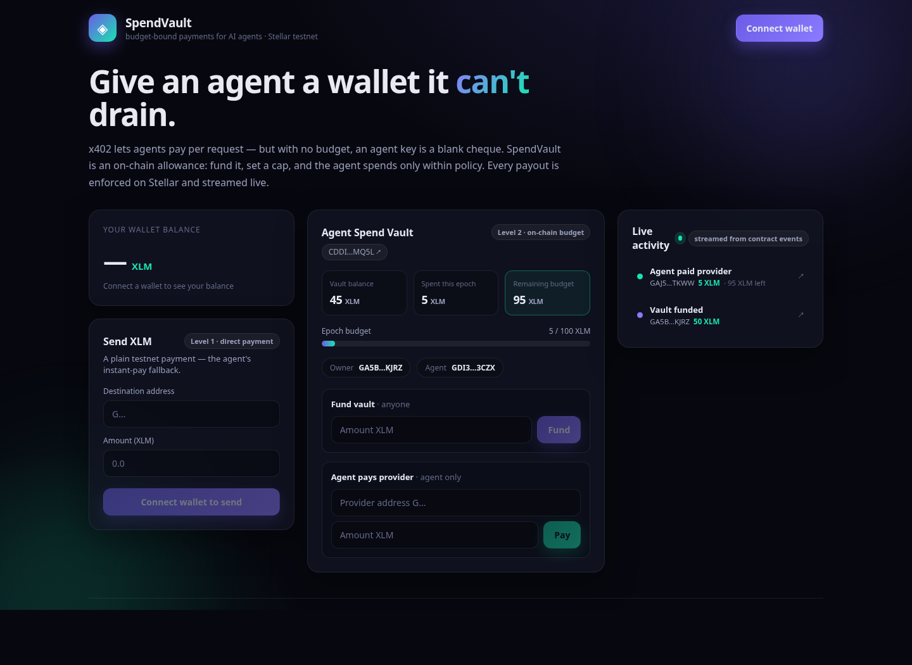
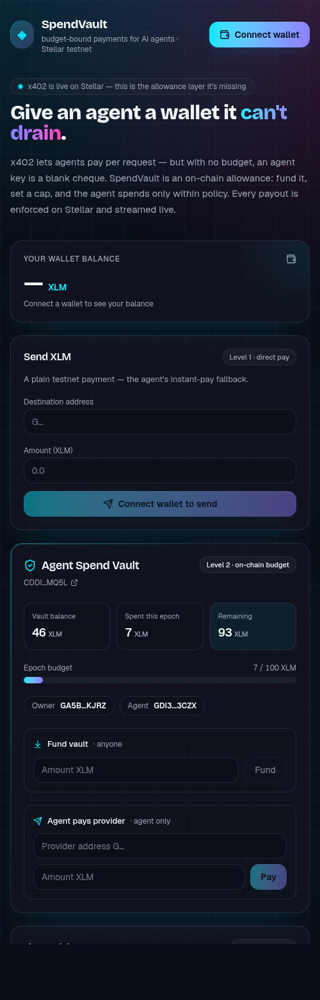

# SpendVault — a budget-enforced spending account for AI agents on Stellar

> Give an autonomous agent a wallet it **can't** drain. SpendVault is an on-chain
> allowance account: the owner funds it and sets a policy (cap per epoch + per-provider
> limits); the agent may only spend **within** that policy. Every payout is an
> inter-contract token transfer that emits an event, streamed live in the UI.

**[▶ Live app](https://stellar-agent-vault.vercel.app)** · **[Factory on Stellar Expert](https://stellar.expert/explorer/testnet/contract/CCZQRQXVI7OKH4JISBQASCFG65XIPT5RF4X7V52OHXO4Z54AY2UNBKTV)** · Stellar testnet · 20 contract tests passing

Built for the **Stellar Journey to Mastery** program and submitted to **Build on Stellar**
(Borderless). It's a production MVP with two on-chain designs: the original **SpendVault**
(an allowance contract) and **AgentWallet** (a Soroban smart account). AgentWallet enforces
the spending policy inside `__check_auth`, so the agent uses ordinary `token.transfer` and
still can't go over budget.

---

## Why this exists

[x402](https://developers.stellar.org/docs/build/agentic-payments/x402) — the agentic
payment protocol now live on Stellar — lets an agent pay per HTTP request via Soroban
authorization. It's stateless: there is no concept of a **budget**, an **allowance**, or a
**spending limit**. Hand an agent a raw key and it can spend everything.

SpendVault adds the missing primitive: **bounded autonomy**.

| Role | Can do |
|------|--------|
| `owner` | fund the vault, set the per-epoch cap, set per-provider limits, rotate the agent key, withdraw |
| `agent` | call `pay(provider, amount)` — and only within policy |

When the agent tries to overspend, the contract rejects it (`BudgetExceeded` /
`ProviderLimitExceeded`). The owner's funds are safe by construction.

## Why Stellar

The design depends on three properties of the network:

- **Agents pay in tiny amounts, so fees decide whether this works.** An agent paying per API
  call moves fractions of a cent at a time. Stellar's fees are sub-cent and predictable, so
  enforcing a budget on every payment costs almost nothing. On a chain where each
  transaction costs a dollar, the control layer would cost more than the payments it guards.
- **Soroban custom accounts make the policy part of authorization.** With `__check_auth`,
  a wallet decides for itself whether a signature is valid. AgentWallet uses that hook to
  enforce its policy, so a transfer that breaks it never gets authorized in the first place.
  The agent needs no special SDK: standard SAC `transfer` calls and normal Stellar tooling
  just work.
- **x402 already runs on Stellar.** Agents can already pay per request here. What's missing
  is a limit on how much they can spend, and that's the layer this project adds on top of
  a payment rail that already exists.

---

## Architecture

```
┌────────────┐   fund / set policy    ┌─────────────────┐   transfer (inter-contract)   ┌──────────────┐
│   Owner    │ ─────────────────────▶ │                 │ ────────────────────────────▶ │  Provider    │
│  (wallet)  │                        │   SpendVault    │                               │  (payee)     │
└────────────┘                        │  (Soroban)      │                               └──────────────┘
┌────────────┐   pay(provider,amt)    │                 │        emits Paid event
│   Agent    │ ─────────────────────▶ │  budget checks  │ ──────────────┐
│  (key)     │                        └─────────────────┘               ▼
└────────────┘                                                    ┌──────────────┐
                                                                  │  Live feed   │
                                                                  │  (frontend)  │
                                                                  └──────────────┘
```

- **Contract:** `contracts/spend-vault` (Rust / Soroban). Epoch-windowed budgeting,
  per-provider limits, events on every state change.
- **Frontend:** `web` (Vite + React + TypeScript). Freighter + StellarWalletsKit,
  balance display, plain XLM send, vault funding, agent payments, and a live event feed.

### Contract interface

| fn | who | effect |
|----|-----|--------|
| `init(owner, agent, token, cap_per_epoch, epoch_len)` | owner | one-time setup |
| `deposit(from, amount)` | anyone | top up the vault |
| `set_policy(cap_per_epoch, epoch_len)` | owner | update budget |
| `set_provider_limit(provider, limit)` | owner | per-provider cap |
| `set_agent(agent)` | owner | rotate spender key |
| `pay(provider, amount) -> remaining` | agent | spend within policy |
| `withdraw(to, amount)` | owner | reclaim funds |
| views | — | `get_owner/agent/cap/epoch_len/spent/remaining/balance` |

Errors: `NotInitialized`, `AlreadyInitialized`, `NotAuthorized`, `BudgetExceeded`,
`ProviderLimitExceeded`, `InsufficientBalance`, `InvalidAmount`.

---

## AgentWallet: the smart-account version

`contracts/agent-wallet` rewrites the core as a **Soroban custom account**. SpendVault
requires the agent to call `pay()`. AgentWallet instead applies its policy in the
**authorization path** of a standard `token.transfer`. The agent behaves like any other
Stellar account, but a payment that breaks the policy never gets authorized.

| Feature | How |
|---------|-----|
| Signer roles | `Admin` (the operator's wallet) and `Spender` (the agent's least-privilege key) |
| Per-transfer cap | per token |
| Rolling epoch cap | the counter is written inside `__check_auth` and resets on its own, with no keeper |
| Recipient allowlist | optional; can be enforced per wallet |
| Admin-only operations | adding signers or changing policy needs an `Admin` signature (`AdminRequired`) |

Errors: `PerTransferExceeded`, `EpochCapExceeded`, `RecipientNotAllowed`, `UnknownSigner`,
`AdminRequired`, `TokenDisabled`, …

- **Gasless and non-custodial.** A relayer (`service/`) pays the fees but never signs, so the
  agent holds no XLM. The operator signs admin actions in their own wallet
  (`signAuthEntry`), and no server ever holds a spending key.
- **`wallet-factory`** deploys wallets and keeps an on-chain registry
  ([`CAORJEWA…DAGVN`](https://stellar.expert/explorer/testnet/contract/CAORJEWAANVZBBTB46T3MA6S6YZGHV5RYOKTVISTQ4T23QQDPOPDAGVN)).
- **`service/src/prove.ts`** proves on testnet that allowed transfers settle and blocked
  ones fail (per-transfer cap, epoch cap, allowlist).
- **Operator console** (the live app): Overview, Agents, Policies, Activity and Keys pages,
  and a provisioning flow that sets the policy when an agent is created.

---

## Deployed (Stellar Testnet)

| What | Address / hash |
|------|----------------|
| **SpendVault contract** (demo) | [`CDDIK44X…MQ5L`](https://stellar.expert/explorer/testnet/contract/CDDIK44X6QKACSGXJ37LKNLTOA3FAFYWMNICUP6MGVWRWHU7ZC4FMQ5L) |
| **VaultFactory** (registry-enabled) | [`CCZQRQXV…BKTV`](https://stellar.expert/explorer/testnet/contract/CCZQRQXVI7OKH4JISBQASCFG65XIPT5RF4X7V52OHXO4Z54AY2UNBKTV) |
| **Token (native XLM SAC)** | `CDLZFC3SYJYDZT7K67VZ75HPJVIEUVNIXF47ZG2FB2RMQQVU2HHGCYSC` |
| SpendVault wasm hash | `3108e0d30fb237d57a089f0ad46e6e97062ba7c1ec6f32a3caf8f2ec64fdff9d` |
| **AgentWallet WalletFactory** | [`CAORJEWA…DAGVN`](https://stellar.expert/explorer/testnet/contract/CAORJEWAANVZBBTB46T3MA6S6YZGHV5RYOKTVISTQ4T23QQDPOPDAGVN) |
| AgentWallet wasm hash | `d5aab32dac58b76727b23b15ff6adf0f19c3ba9c0f44deb4c71ac589b16ee052` |

> The factory exposes an on-chain **`all_vaults()`** registry (+ `admin()`) that backs the admin
> dashboard — a complete vault list independent of RPC event retention. The earlier factory
> (`CDWT4DES…J7S2`) remains valid on-chain as Level 1–3 belt evidence.

**Transaction hashes (verifiable on Stellar Explorer):**

| Action | Tx |
|--------|----|
| Deploy SpendVault | [`e8f89957…668930`](https://stellar.expert/explorer/testnet/tx/e8f89957a31d469c11062ec0161dbff50c49bcff8ecd48e4ae52ad55ef668930) |
| Init SpendVault | [`d5e96591…5da98c`](https://stellar.expert/explorer/testnet/tx/d5e96591efc00472cda8556e2ea89cf7f5dec72dddf25c88ce445ae0375da98c) |
| Deposit (fund vault) | [`c553d777…691df`](https://stellar.expert/explorer/testnet/tx/c553d777cb50dc887164daad70577798d618d405c2dcc7a46d8c66e7a6f691df) |
| **Agent `pay` (contract call)** | [`a861ea73…ec7ad`](https://stellar.expert/explorer/testnet/tx/a861ea73a93c59ec3e634794cf1a6cb9258fa2fe1bdf12abb4088b7aef5ec7ad) |
| Init VaultFactory | [`a02f54d9…a1c27`](https://stellar.expert/explorer/testnet/tx/a02f54d9965e91be2600fd2a109fd39c3a664e51e40fa60e889db5adacfa1c27) |
| **`create_vault` (deploy+init child)** | [`f9c07c17…4a63f`](https://stellar.expert/explorer/testnet/tx/f9c07c178e9a54d221719eeac8e3ad385d8b2273eaa796a7b532846c0df4a63f) |

> The `pay` tx emits a `transfer` event (vault → provider — an inter-contract SAC call) and a
> `paid` event `[amount, remaining_budget, epoch]`, streamed live in the UI. `create_vault`
> deploys **and** initializes a child SpendVault in a single transaction (two inter-contract ops).

---

## Production & observability (Level 4)

The app ships with product analytics, error monitoring, and in-app feedback. All three are
**env-gated** — with no keys they compile to no-ops, so local dev and CI never phone home, and
they light up the moment keys are present.

| Concern | Tool | Wiring | Enable with |
|---------|------|--------|-------------|
| Product analytics | **PostHog** | `web/src/lib/analytics.ts` — users identified by wallet address; events on connect, send, deposit, agent payment, policy change, withdraw | `VITE_POSTHOG_KEY` |
| Error monitoring | **Sentry** | `web/src/lib/monitoring.ts` — `captureException` at every catch site; branded `CrashFallback` via `ErrorBoundary` | `VITE_SENTRY_DSN` |
| User feedback | **PostHog event** | `web/src/components/FeedbackWidget.tsx` — floating 1–5 rating + note → `feedback_submitted`, attributed to the wallet | `VITE_POSTHOG_KEY` |

Wallet-based identity means the "N users + wallet interactions" and feedback reports fall
straight out of the PostHog dashboard — every event is attributable to a Stellar address.

### Admin dashboard (`/#/admin`)

An operator view that answers what off-chain analytics can't: the **on-chain** aggregate.
It reads the factory's `all_vaults()` registry and each vault's live state, then shows:

- KPIs — vaults created, **total value locked**, spent this epoch, unique owners
- a registry table — per vault: owner, agent, balance, spend, and epoch-budget meter
- deep links to the **PostHog** (product) and **Sentry** (errors) dashboards for the off-chain side

Access is gated to the on-chain factory `admin()` **or** any wallet in `VITE_ADMIN_ADDRESS`.
This is the on-chain complement to PostHog/Sentry — those cover the funnel and crashes; this
covers settled value and policy state, which live only on-chain.

### Deploy (Vercel)

`web/vercel.json` configures a Vite build with an SPA rewrite.

```bash
# Root Directory: web
# Build: pnpm build   ·   Output: dist
```

Set the `VITE_*` vars from `.env.example` in the Vercel project (network + contract ids are
required; the two observability keys are optional but recommended for the graded submission).

**Live app:** https://stellar-agent-vault.vercel.app

## Run locally

### Prerequisites
- Rust + `wasm32v1-none` target, [`stellar-cli`](https://developers.stellar.org/docs/tools/cli)
- Node 20+ and `pnpm`
- [Freighter](https://www.freighter.app/) browser extension, set to **Testnet**

### Contract
```bash
cd contracts/spend-vault
stellar contract build
cargo test
```

### Deploy to testnet
```bash
stellar keys generate --global deployer --network testnet --fund
stellar contract deploy --wasm target/wasm32v1-none/release/spend_vault.wasm \
  --source deployer --network testnet
```

### Frontend
```bash
cd web
cp .env.example .env   # set VITE_CONTRACT_ID etc.
pnpm install
pnpm dev
```

---

## Screenshots

**Desktop — live vault state + streamed event feed**



**Mobile responsive**



**Analytics & monitoring**


---

## How it relates to x402

[x402](https://developers.stellar.org/docs/build/agentic-payments/x402) is now live on Stellar
(testnet + mainnet): an agent signs a Soroban authorization to pay per HTTP request, settled in
~5s for ~$0.00001. It is intentionally **stateless** — there is no budget or allowance layer.
SpendVault is the complementary primitive: the agent's funds live in the vault, and an x402
payment becomes a `pay(provider, amount)` call that the contract only honors **within policy**.
The roadmap below wires the vault behind an x402 facilitator so the spend cap is enforced on
every per-request payment.

## Tech

- **Contracts:** Rust / Soroban (`soroban-sdk 25`): spend-vault, vault-factory, agent-wallet
  (custom account), wallet-factory. 20 unit tests, including real ed25519 `__check_auth` policy paths.
- **Service:** TypeScript relayer + testnet proof scripts (`service/`).
- **Frontend:** Vite + React + TypeScript, `@stellar/stellar-sdk`, StellarWalletsKit.
- **CI:** GitHub Actions — contract tests + wasm build + frontend typecheck/build (`.github/workflows/ci.yml`).

## Belt coverage

| Belt | Requirement | Where |
|------|-------------|-------|
| White | Freighter connect/disconnect | `web/src/components/WalletButton.tsx` |
| White | XLM balance displayed | `web/src/components/BalanceCard.tsx` |
| White | Send XLM on testnet + tx feedback | `web/src/components/SendXlmCard.tsx`, `lib/stellar.ts` |
| Yellow | StellarWalletsKit multi-wallet | `web/src/lib/wallet.ts` |
| Yellow | Deployed contract called from frontend | `web/src/lib/contract.ts` (deposit/pay) |
| Yellow | Real-time events / status | `web/src/components/ActivityFeed.tsx`, toasts |
| Yellow | 3+ error types handled | `web/src/lib/errors.ts` |
| Orange | Advanced contract + inter-contract | `pay` → SAC, `VaultFactory.create_vault` |
| Orange | Tests | `contracts/*/src/test.rs` (20 passing) |
| Orange | CI/CD | `.github/workflows/ci.yml` |
| Orange | Mobile responsive | `docs/mobile.png` |

## Level 4 — Green Belt checklist

| Requirement | Status | Evidence |
|-------------|--------|----------|
| Production-ready MVP, stable architecture | ✅ | contracts on testnet + typed frontend |
| Mobile responsive UI | ✅ | responsive grid; `docs/mobile.png` |
| Loading + error states | ✅ | toasts, `friendlyError`, `CrashFallback` |
| Monitoring + analytics integration | ✅ | PostHog + Sentry (`lib/analytics.ts`, `lib/monitoring.ts`) |
| On-chain operator dashboard | ✅ | `components/AdminDashboard.tsx` + factory `all_vaults()` |
| In-app feedback collection | ✅ | `components/FeedbackWidget.tsx` |
| Production deployment | ✅ | https://stellar-agent-vault.vercel.app |
| 10+ real users + wallet-interaction proof | ⏳ | PostHog "identified users" export — _in progress_ |
| Basic user feedback summary | ⏳ | PostHog `feedback_submitted` events — _in progress_ |
| 15+ meaningful commits | ✅ | `git log` |
| Public GitHub repo | ✅ | this repo |

## Run the deployment workflow

```bash
./scripts/deploy.sh   # build, fund a key, deploy SpendVault + VaultFactory, init, demo a pay
```

## License
MIT
